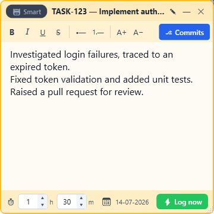
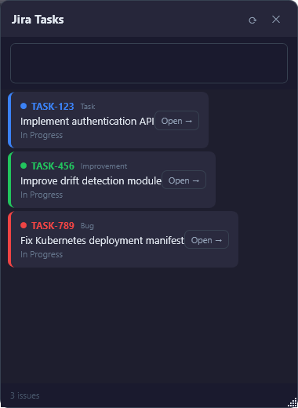
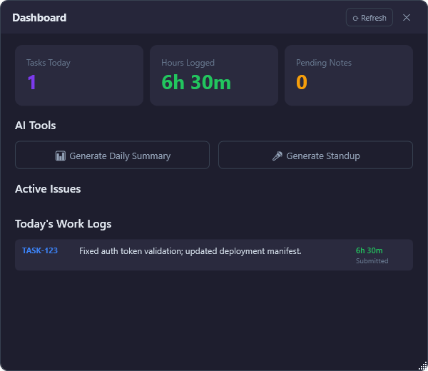
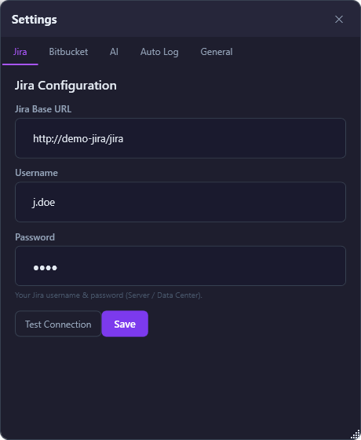

<div align="center">


# Jira WorkLog Assistant

### Capture work as it happens. Let AI write your Jira work logs.

A lightweight Windows system-tray app that turns quick sticky-note scribbles into clean, professional Jira work logs — and submits them for you.

[](https://github.com/Fasil-OK/JiraWorkLogAssistant/actions/workflows/build.yml)
[](https://github.com/Fasil-OK/JiraWorkLogAssistant/releases/latest)
[](https://github.com/Fasil-OK/JiraWorkLogAssistant/releases)
[](LICENSE)
[](#-installation)
[](https://dotnet.microsoft.com/)
[](https://github.com/Fasil-OK/JiraWorkLogAssistant/stargazers)

**[⬇️ Download](https://github.com/Fasil-OK/JiraWorkLogAssistant/releases/latest)** &nbsp;·&nbsp; **[✨ Features](#-features)** &nbsp;·&nbsp; **[🚀 Getting started](#-getting-started)** &nbsp;·&nbsp; **[🛠️ Build](#️-build-from-source)** &nbsp;·&nbsp; **[📖 Full guide](docs/index.html)**

</div>

---

## Why?

By the end of the day you can't remember exactly what you did — so Jira work logs get rushed, vague, or skipped. **Jira WorkLog Assistant** fixes that: jot one line whenever you finish something, and when you're ready, AI turns those notes into polished work logs and logs them against the right issues.

> **Private by design** — everything runs locally, your credentials are encrypted, and with a self-hosted model your notes never leave your network.

## 📸 Screenshots

| Sticky notes — one per task | Smart Jira task browser |
| :---: | :---: |
|  |  |
| **Dashboard — summaries & standup** | **Settings — connect your tools** |
|  |  |

## ✨ Features

- 🗒️ **Sticky notes that stay out of your way** — one colour per task, always a double-click away in the system tray. Open many at once; a task can't be opened twice.
- 🤖 **AI-polished work logs** — your raw, terse notes become clear, point-by-point entries. Bring your own OpenAI-compatible endpoint (cloud or self-hosted).
- 🧠 **Smart Distribution** — worked on five tasks? Write everything in one note, enter your total hours, and AI matches each note to the right issue and splits the time — with a review step before anything is submitted.
- 🔀 **Bitbucket integration** — one click pulls today's commit messages from your per-task branches and summarises them into work-log points.
- ⏰ **Auto-log** — set a daily time and your notes are submitted to Jira automatically.
- ✅ **Review before submit** — nothing reaches Jira until you approve it; clear green success / red error feedback.
- 📊 **Dashboard** — daily hours, an AI daily summary, and a ready-made scrum standup (Update / Blockers / Risks).
- ✍️ **Rich text & real timestamps** — bold/italic/lists/font-size, an hours–minutes picker and a date picker; logs use your actual time.
- 📌 **Pin Notes Right** — snap every open note to the right edge, stacked and always-on-top.
- 📴 **Offline-friendly** — keep taking notes with no connection; sync and submit when you're back.

## 🧭 Two ways to log

| | **Manual mode** | **Smart mode** |
|---|---|---|
| Best for | One task at a time | A day spent across many tasks |
| You do | Pick a task, write notes, set time | Dump all notes, enter total hours |
| AI does | Polishes each note into a point | Matches notes → issues, splits hours |
| Review | Optional (toggle AI polishing) | Always reviewed before submit |

Prefer to log things exactly as written? Turn **AI polishing off** and your text goes straight to Jira, formatting preserved.

## 🚀 Getting started

### 💾 Installation

1. Download **`JiraWorkLogAssistant-Setup-x.y.z.exe`** from the [latest release](https://github.com/Fasil-OK/JiraWorkLogAssistant/releases/latest).
2. Double-click it. No administrator rights and no .NET install needed — the runtime is bundled.
3. If Windows SmartScreen appears (the installer is unsigned), click **More info → Run anyway**.
4. The app launches into your **system tray** (bottom-right, near the clock). Double-click the icon to open a note.

> **Upgrading?** Just run the newer setup — it upgrades in place and keeps your settings and data.

### 🔌 Configure (one-time)

Right-click the tray icon → **Settings**. Everything is stored locally and encrypted.

| Service | What to enter |
|--------|----------------|
| **Jira** (Server / Data Center) | Base URL (incl. context path, e.g. `/jira`), username, password → **Test** → **Sync Jira** |
| **Bitbucket** (Data Center) | Username, password, and one or more full repo URLs → enables the **⎇ Commits** button |
| **AI** (OpenAI-compatible) | API base URL ending in `/v1`, optional API key & model name. Toggle **AI polishing**; customise the system prompt |
| **Auto Log / General** | Daily auto-log time, start-with-Windows, idle reminders, Smart confidence threshold |

### ⚡ Log your first work

1. Double-click the tray icon → search & pick a Jira task.
2. Jot notes as you go, or click **⎇ Commits** to import today's commits.
3. Set your time, click **⚡ Log now** → review the wording → **Submit**. Done.

📖 **Prefer a visual walkthrough?** Open [`docs/index.html`](docs/index.html) for the full illustrated guide and FAQ.

## 🔗 Works with

- **Jira** Server / Data Center (REST API v2, username + password)
- **Bitbucket** Data Center (REST API v1)
- **Any OpenAI-compatible AI** — OpenAI, Azure OpenAI, or a self-hosted gateway (vLLM, Ollama, LM Studio, Hugging Face router, …). Streaming (SSE) gateways are handled automatically.

## 🏗️ Tech stack

- **.NET 8** · **WPF** · **MVVM** ([CommunityToolkit.Mvvm](https://github.com/CommunityToolkit/dotnet))
- **EF Core** + **SQLite** for local storage
- **Microsoft.Extensions.Hosting** for dependency injection & the background auto-logger
- **Serilog** for diagnostics · **Windows DPAPI** for credential encryption
- Packaged with **[Inno Setup](https://jrsoftware.org/isinfo.php)** as a per-user installer (no admin, runtime bundled)

## 🛠️ Build from source

**Prerequisites:** [.NET 8 SDK](https://dotnet.microsoft.com/download/dotnet/8.0) and Windows 10/11.

```powershell
git clone https://github.com/Fasil-OK/JiraWorkLogAssistant.git
cd JiraWorkLogAssistant

# Run it
dotnet run --project src/JiraWorkLogAssistant/JiraWorkLogAssistant.csproj

# Or publish a self-contained single EXE
dotnet publish src/JiraWorkLogAssistant/JiraWorkLogAssistant.csproj `
  -c Release -r win-x64 --self-contained true -p:PublishSingleFile=true -o publish/app
```

Full build, publish, and installer instructions are in **[BUILD.md](BUILD.md)**.

## 🔒 Privacy & security

- All data lives locally at `%LocalAppData%\JiraWorkLogAssistant\` (SQLite database + logs) and is removed on uninstall.
- Jira, Bitbucket, and AI credentials are encrypted at rest with Windows DPAPI.
- No telemetry. Nothing is sent anywhere except the Jira / Bitbucket / AI endpoints **you** configure.

## 🤝 Contributing

Contributions are welcome! See **[CONTRIBUTING.md](CONTRIBUTING.md)** to get started, or open an [issue](https://github.com/Fasil-OK/JiraWorkLogAssistant/issues).

If this app saves you time, please consider leaving a ⭐ — it helps others find it.

## 📄 License

Released under the [MIT License](LICENSE).

<div align="center">
<br/>
<b>Stop remembering. Start logging.</b>
</div>
